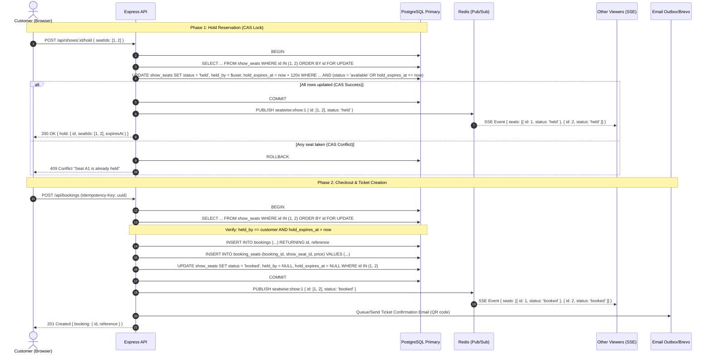
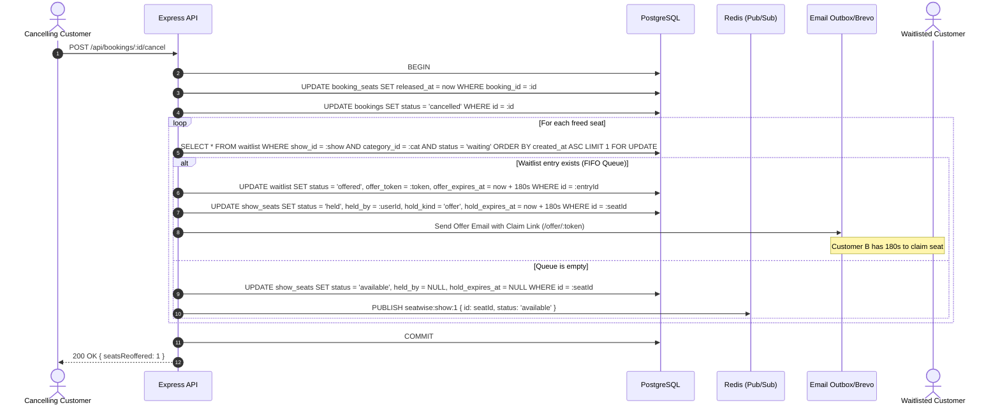
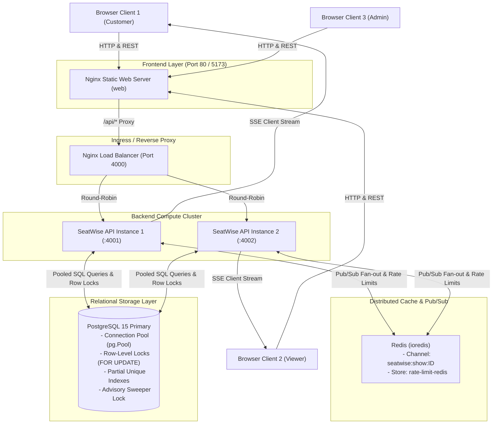
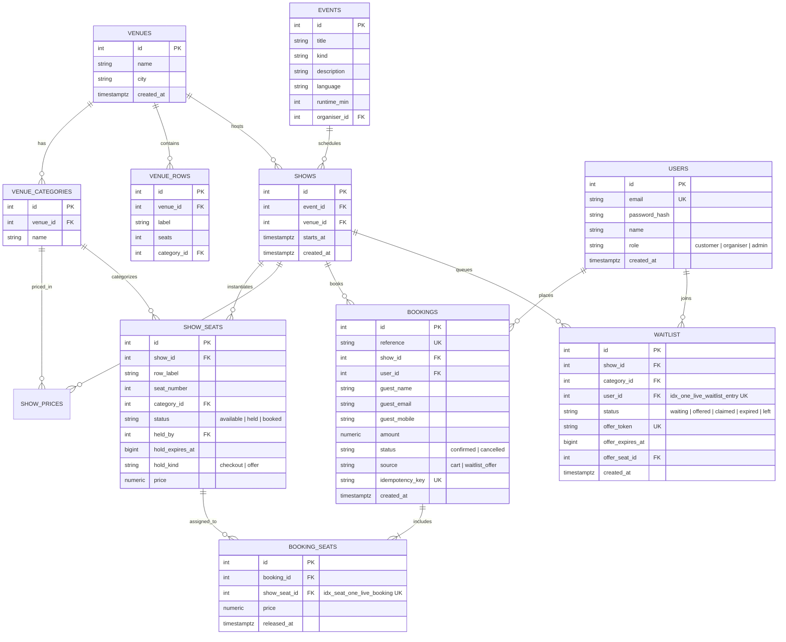

# SeatWise: system design

## Shape of the system

An Express API over SQLite, plus a React single-page frontend. The contended
state is one table, `show_seats`: a row per seat per showing, with a status of
`available`, `held` or `booked`. Every booking decision is a transition on one of
those rows. SQLite is embedded, so there is no cache or broker to run, and no
lock that can be lost to an eviction or a dead worker.

## Seat holds and the TTL

Selecting seats reserves nothing. Pressing *Hold* sets `status = 'held'`, records
the holder, and stamps `hold_expires_at` at `now + HOLD_TTL_SECONDS` (600 by
default). Held seats read as unavailable to everyone else, and only the holder
is told the expiry, so the map cannot time other people's checkouts.

Crucially, expiry is **derived, not scheduled**. A lapsed hold is treated as
free in three places:

1. **On read.** The seat map reports a hold past its expiry as available, before
   cleanup runs.
2. **On write.** The statement granting a hold matches a seat that is available
   *or* held with a lapsed expiry, so the next customer takes it directly.
   Checkout re-checks `hold_expires_at > now` as it writes.
3. **On a timer.** A sweep every few seconds rewrites lapsed rows back to
   available and pushes the change to browsers.

Only the first two affect correctness; the timer just notifies browsers and
tidies rows, so a missed tick cannot mis-sell a seat. In a scheduler-only design
a dead worker leaves seats locked indefinitely.

## Preventing double sales

The system never checks availability and then writes. It writes conditionally
and reads the outcome:

```sql
UPDATE show_seats
   SET status = 'held', held_by = ?, hold_expires_at = ?, hold_kind = 'checkout'
 WHERE id = ? AND show_id = ?
   AND (status = 'available'
        OR (status = 'held' AND hold_kind = 'checkout' AND hold_expires_at <= ?));
```

The row count is the answer: one means the seat is yours, zero means someone got
there first and the caller receives `409`. Because the condition is evaluated at
write time, a stale read cannot win a seat.

Each hold and checkout runs in a `BEGIN IMMEDIATE` transaction, taking the write
lock up front; a deferred transaction acquires it at its first write, so two
attempts could both read "available" and one would fail late. Multi-seat holds
are all-or-nothing.

Behind that sit constraints the application cannot bypass. `booking_seats` has a
partial unique index on `show_seat_id` where `released_at is null`, so a seat
appears in only one live booking whatever writes it, while cancelled rows remain
for history. Check constraints on `show_seats` tie
`hold_expires_at`, `held_by` and `hold_kind` to `status = 'held'`, so a stale
expiry cannot linger on a booked seat and let a sweep free something paid for.

## Waitlist auto-assignment

Once a category has nothing gettable, customers can queue for it. Joining is
refused while any seat remains available, and a lapsed hold counts as available,
so a stale hold cannot fake a sold-out house.

When a seat is freed, one function decides its fate: offer it to the
longest-waiting customer for that category, or return it to sale if nobody is
queued. Cancellations and abandoned holds both call it, so a queue is never
bypassed by whoever refreshes the seat map fastest.

It runs inside the caller's transaction and returns the emails to send rather
than sending them, so a rolled-back transaction cannot notify someone about a
seat they never got.

## Time-limited offers

An offer holds the seat with `hold_kind = 'offer'`, marks the entry `offered`
with an expiry of `now + OFFER_TTL_SECONDS`, and emails a link carrying a
single-use random token. Opening it also requires being signed in as the customer
it was made to, so a forwarded link is useless. Claiming converts it into a
booking with its own QR ticket.

Offer holds are deliberately a distinct kind, and the generic sweep skips them:
an unclaimed offer has somewhere to go rather than back to sale. When the window
closes the sweep marks the entry `expired` and re-runs the same assignment,
walking the queue until someone claims or it empties. Leaving the queue while
holding an offer hands the seat straight on.

## Live seat status

Changes reach browsers over server-sent events, one stream per showing, carrying
only seat id, status and expiry. The holder is never broadcast, so the stream
cannot leak who is buying what.

## Database & Concurrency Architecture: Migration to PostgreSQL

SeatWise uses **PostgreSQL 15+** with connection pooling (`pg.Pool`), versioned migrations via `node-pg-migrate`, and fine-grained row-level locking.

### Why PostgreSQL?
1. **Horizontal Scalability**: Multiple Express API instances can run behind a load balancer without colliding on embedded file locks.
2. **True Row-Level Locking**: Concurrent operations on different shows or non-overlapping seat selections proceed in parallel without serializing the whole database.
3. **Multi-Instance Sweeper Coordination**: Sweepers across multiple application instances use PostgreSQL advisory locks (`pg_try_advisory_lock`), ensuring exactly one active sweeper without requiring external distributed lock managers.

### Locking Strategy & Deadlock Prevention

1. **Consistent Lock Ordering (`ORDER BY id FOR UPDATE`)**:
   For multi-seat holds, all seat IDs in the batch are sorted in strictly ascending numerical order before acquiring row locks:
   ```sql
   SELECT id, status, held_by, hold_kind, hold_expires_at, price
     FROM show_seats
    WHERE show_id = $1 AND id = ANY($2::int[])
    ORDER BY id
      FOR UPDATE;
   ```
   If User A requests seats `[1, 2, 3]` and User B requests `[3, 2, 1]`, both acquire locks in order `1 -> 2 -> 3`, eliminating cyclical wait conditions and preventing deadlocks.

2. **Atomic Compare-And-Swap (CAS) Conditional Update**:
   Seat holds are claimed conditionally in a single SQL operation:
   ```sql
   UPDATE show_seats
      SET status = 'held', held_by = $1, hold_expires_at = $2, hold_kind = 'checkout'
    WHERE id = $3 AND show_id = $4
      AND (status = 'available'
           OR (status = 'held' AND hold_kind = 'checkout' AND hold_expires_at <= $5));
   ```
   If `rowCount === 1`, the hold was successfully claimed or re-claimed from a lapsed holder. If `0`, another transaction won the seat and the entire multi-seat transaction is rolled back with a `409 Conflict`.

3. **Bounded Retries on Serialization & Deadlock Codes**:
   The transaction runner (`withTransaction`) catches retryable PostgreSQL errors (`40001` serialization failure, `40P01` deadlock detected) and retries up to 3 times with exponential backoff and randomized jitter (10–35ms).

4. **Timestamp Storage Strategy**:
   Hold timestamps are preserved as epoch milliseconds stored in PostgreSQL `BIGINT` (type parser configured with `parseInt(val, 10)`). This prevents timezone and ISO serialization mismatches and maintains zero-overhead compatibility with frontend countdown timers (`expiresAt - Date.now()`).

5. **Partial Unique Indexes**:
   - `idx_seat_one_live_booking`: `ON booking_seats(show_seat_id) WHERE released_at IS NULL` guarantees at the storage engine level that a seat can never have more than one active booking.
   - `idx_one_live_waitlist_entry`: `ON waitlist(show_id, category_id, user_id) WHERE status IN ('waiting', 'offered')` prevents duplicate active queue entries.

6. **Advisory Locking for Distributed Sweeper**:
   ```sql
   SELECT pg_try_advisory_lock(847291038) AS locked;
   ```
   The background sweeper attempts to acquire session lock `847291038`. If another instance is sweeping, it skips immediately without blocking. On completion or error, `pg_advisory_unlock(847291038)` releases the lock in a `finally` block. If an instance crashes, PostgreSQL automatically releases session advisory locks.

## Distributed Multi-Instance Real-time (Redis Pub/Sub)

Seat holds and bookings stay strictly in PostgreSQL as the single source of truth. Redis is used solely for inter-instance broadcast and distributed rate limiting:


## Architectural & Sequence Diagrams

### 1. Hold Reservation & Checkout Flow (CAS Row Lock)



### 2. Waitlist Cascade on Booking Cancellation



### 3. Distributed Deployment Architecture



### 4. Entity-Relationship (ER) Diagram


